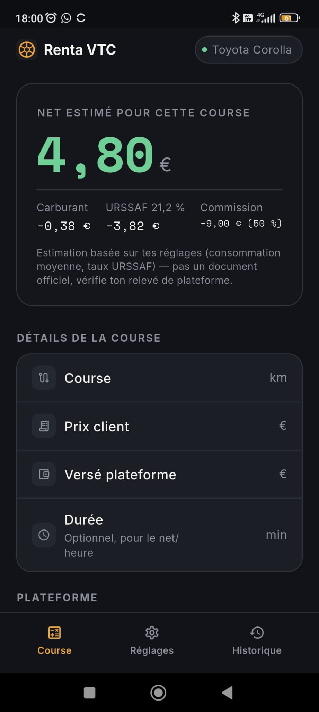
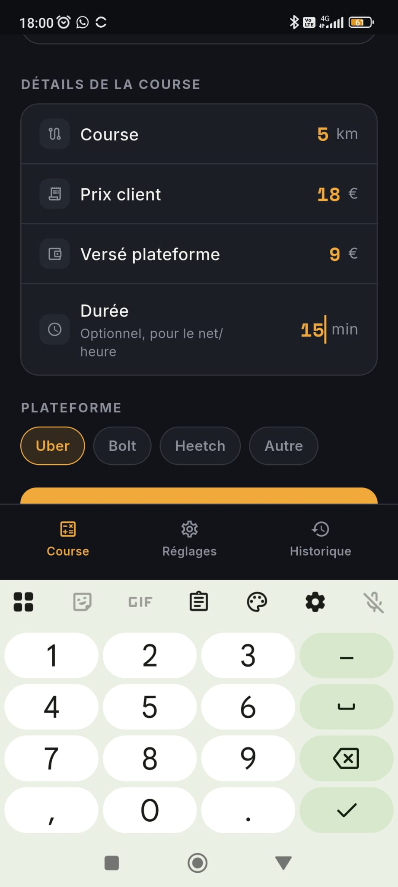
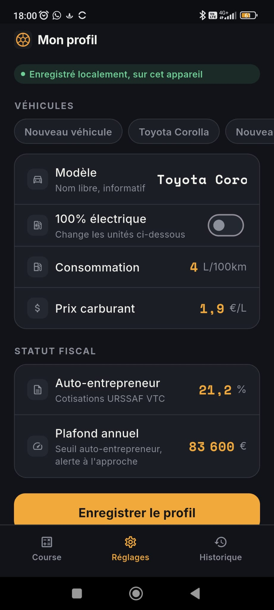
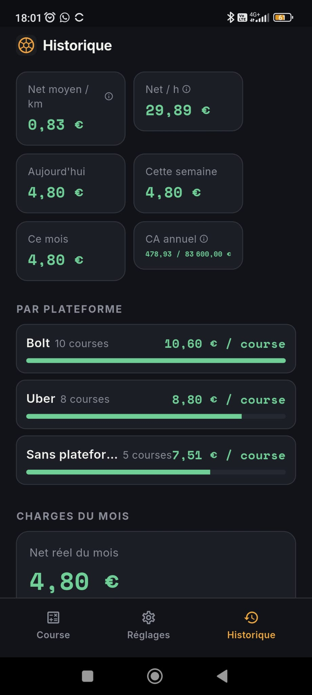
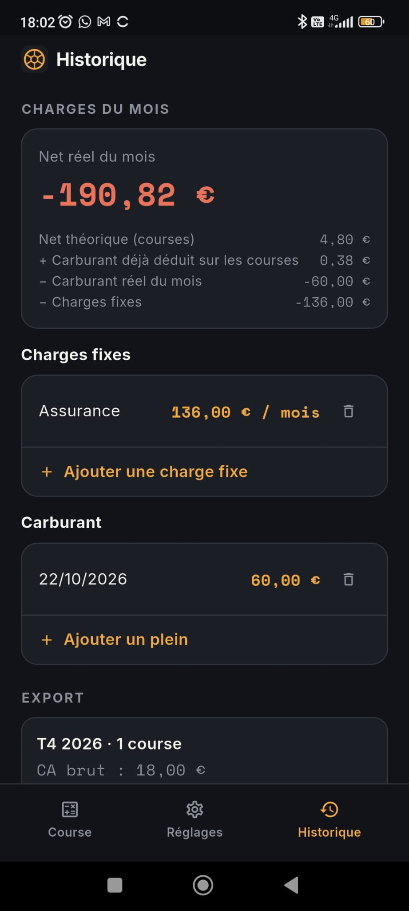
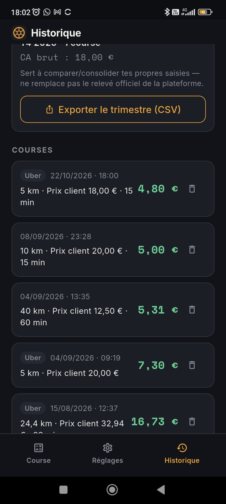

# Renta VTC

Application mobile Flutter pour chauffeurs VTC (Uber, Bolt, Heetch...) sous statut
auto-entrepreneur. Elle calcule, course par course, ce qu'il reste **réellement** au
chauffeur une fois déduits le carburant et les cotisations URSSAF — le prix affiché par
la plateforme ne reflète ni l'un ni l'autre.

100% local : aucune donnée n'est envoyée à un serveur, pas de compte utilisateur, pas de
backend. Voir [`CLAUDE.md`](./CLAUDE.md) pour la spécification complète (logique métier,
design system, écrans, modèle de monétisation).

## Aperçu

<table>
  <tr>
    <td width="25%"></td>
    <td width="25%"></td>
    <td width="25%"></td>
    <td width="25%"></td>
  </tr>
  <tr>
    <td width="25%" align="center">Net réel d'une course</td>
    <td width="25%" align="center">Saisie de la course</td>
    <td width="25%" align="center">Profil véhicule et URSSAF</td>
    <td width="25%" align="center">Statistiques et plateformes</td>
  </tr>
  <tr>
    <td width="25%"></td>
    <td width="25%"></td>
    <td width="25%"></td>
    <td width="25%"></td>
  </tr>
  <tr>
    <td width="25%" align="center">Charges du mois</td>
    <td width="25%" align="center">Historique et export CSV</td>
    <td width="25%"></td>
    <td width="25%"></td>
  </tr>
</table>

## Stack

- **Flutter** (Dart) — Android, iOS, web
- **shared_preferences** pour la persistance locale (profils véhicule, historique, réglages)
- **share_plus** / **file_picker** pour l'export/import de fichiers (CSV, sauvegarde JSON)
- **in_app_purchase** pour l'abonnement Premium (Google Play Billing / StoreKit)
- **flutter_local_notifications** pour l'alerte de seuil auto-entrepreneur
- **google_mobile_ads** pour la bannière publicitaire (utilisateurs non-premium)

## Démarrer

```bash
flutter pub get
flutter analyze
flutter test
flutter run          # sur un appareil/émulateur connecté
```

`in_app_purchase` et `google_mobile_ads` ne fonctionnent pas sur le web (limitation des
plugins, pas un bug) : en aperçu web, l'app reste utilisable via la bascule
**"Premium (mode test)"** dans Réglages, et la bannière publicitaire ne s'affiche
simplement pas.

## Structure

```
lib/
├── main.dart              # Point d'entrée, état racine (RootShell), routing par onglets
├── models/                # DriverProfile, RideResult, RideEntry, SubscriptionStatus
├── services/               # Logique métier pure (calcul, stats, export, stockage, IAP...)
├── screens/                # Course, Réglages, Historique, Paywall
├── widgets/                # Composants réutilisables du design system
└── theme/                  # Couleurs, typographie
test/                       # Tests unitaires des services
```

Toute la logique de calcul/agrégation vit dans `services/`, jamais dans les écrans —
voir §12 du `CLAUDE.md`.

## Tests

```bash
flutter test
```

Couvre `CalculatorService` (règles de calcul, y compris la règle URSSAF sur le prix
client et non le montant versé plateforme), `StatsService`, `ExportService` et
`BackupService`.

## CI

`.github/workflows/build.yml` : à chaque push/PR sur `main`, deux jobs indépendants
(`build_android`, `build_ios`) exécutent `pub get → analyze → test → build` et joignent
l'APK / l'app iOS non signée au run. Pas de publication automatisée sur les stores.

## Déploiement

Voir §9 du `CLAUDE.md` pour la procédure complète (signature Android, compte développeur
Apple, publication Play Store / App Store). Avant publication, remplacer les IDs de test
Google (AdMob, produits `in_app_purchase`) par de vrais identifiants issus de tes propres
comptes développeur.
